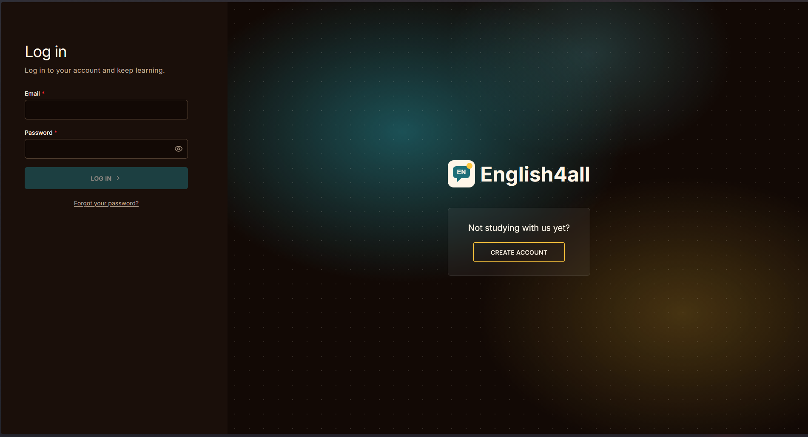
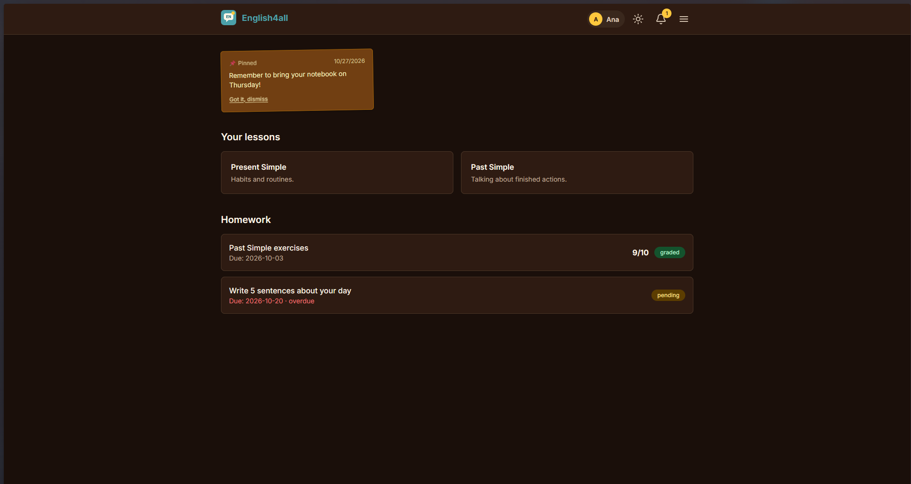
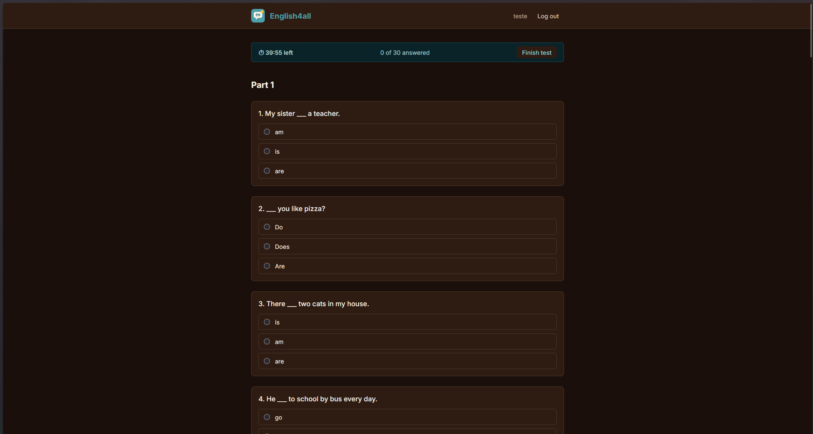
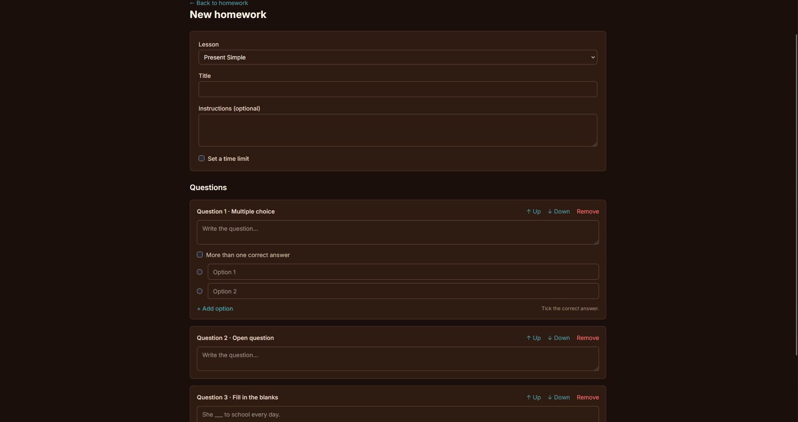
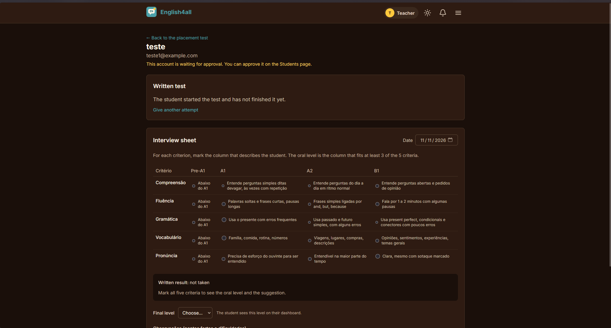
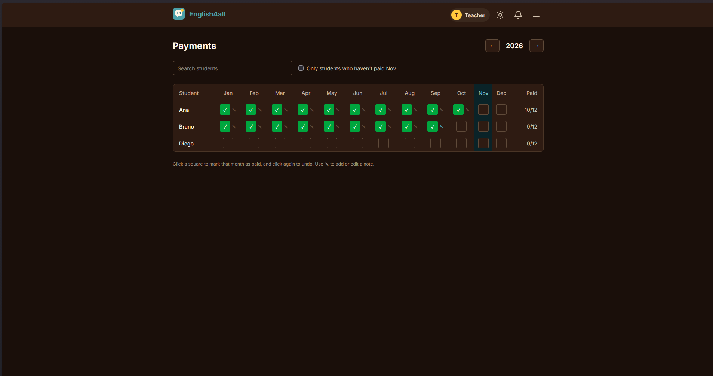
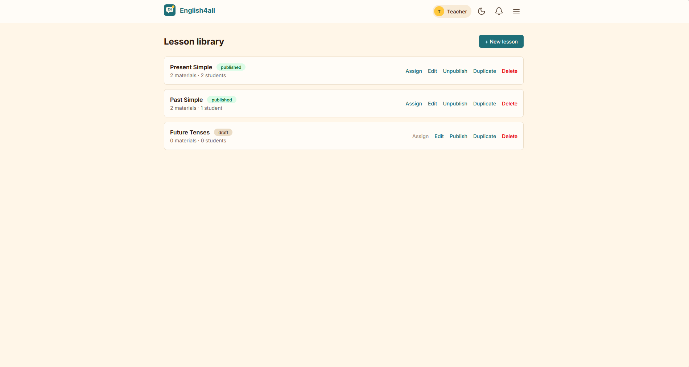
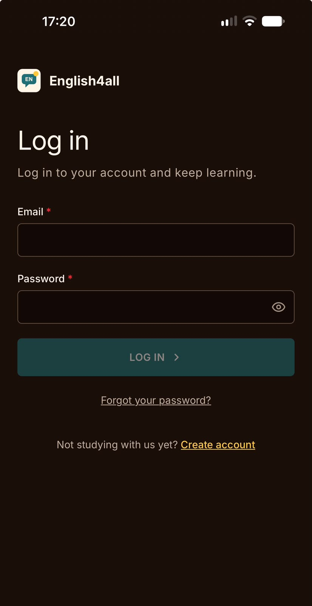
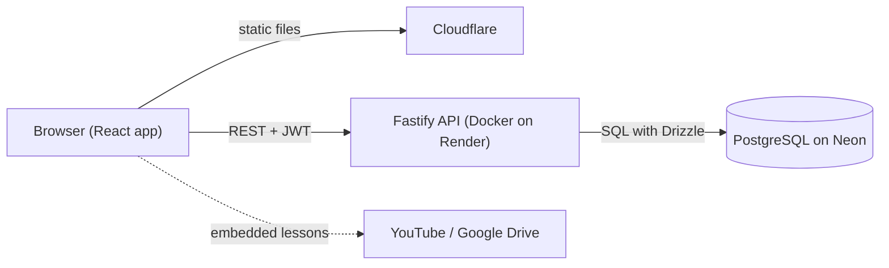

# English Lessons

A web platform where an English teacher shares lessons and homework with their students, tests their level and keeps track of the classes. It is a full-stack project: a React front-end, a Fastify API and a PostgreSQL database, deployed on free-tier hosting.

<!-- Live site: add the link here if you want to show it -->

<p align="center">
  
</p>

## Screenshots

<table>
  <tr>
    <td><br /><sub>Student dashboard</sub></td>
    <td><br /><sub>Placement test with a reading text and a timer</sub></td>
  </tr>
  <tr>
    <td><br /><sub>Homework builder with three question types</sub></td>
    <td><br /><sub>Interview sheet for the conversation test</sub></td>
  </tr>
  <tr>
    <td><br /><sub>Monthly payments grid</sub></td>
    <td><br /><sub>Light theme</sub></td>
  </tr>
</table>

<p align="center">
  <br />
  <sub>The whole site works on phones</sub>
</p>

## Features

### For students
- **Sign up and placement test:** 30 multiple-choice questions in three parts (A1, A2, B1), with reading texts, an optional timer and blank answers allowed. The level appears right after the test.
- **Dashboard:** assigned lessons, homework, sticky notes from the teacher, and the final level.
- **Lessons:** videos (YouTube), PDFs and audio (Google Drive or direct links).
- **Homework:** multiple choice (one or several answers), fill in the blanks and open questions. Some homework has a time limit and is sent automatically when time runs out. Graded homework shows the grade, the teacher's feedback and the correct answers.
- **Notifications**, light and dark themes, change password and "forgot my password".

### For the teacher
- **Lesson library:** draft and published lessons with several materials, duplicate and assign to students.
- **Students:** approve or reject sign-ups, add students with a temporary password, reset passwords, deactivate.
- **Homework builder:** three question types, an optional time limit, assignment with due dates, grading, and another attempt when needed. Questions lock once a student has answered.
- **Placement test results:** score per part, the answers with the answer key, and an interview sheet based on a five-criteria rubric that suggests the final level.
- **Payments:** a yearly grid where months are marked as paid, with notes.
- **Sticky notes and notifications** for students, and notifications for sign-ups, finished tests and submitted homework.

## Tech stack

| Area | Technology |
| --- | --- |
| Front-end | React, TypeScript, Vite, Tailwind CSS, React Router, TanStack Query |
| API | Node.js, Fastify, Zod (validation and types), TypeScript |
| Database | PostgreSQL with Drizzle ORM and SQL migrations |
| Security | Argon2 password hashing, JWT bearer tokens, role checks, rate limiting |
| Infrastructure | Docker, Cloudflare (front-end), Render (API), Neon (database) |

## Architecture



```
english-lessons/
├── api/
│   ├── src/
│   │   ├── db/          # schema, migrations, seed and maintenance scripts
│   │   ├── homework/    # question rules, answer checks, timers
│   │   ├── placement/   # placement test content, scoring and interview rules
│   │   ├── plugins/     # authentication
│   │   └── routes/      # one file per area (auth, students, lessons, homework...)
│   ├── scripts/         # backup script
│   └── Dockerfile
├── web/
│   └── src/
│       ├── api/         # fetch client
│       ├── components/
│       ├── context/     # authentication
│       ├── hooks/       # React Query hooks, one per resource
│       ├── pages/       # student pages, and admin/ for the teacher
│       └── utils/
├── docs/screenshots/
└── docker-compose.yml
```

## Design notes

- **Roles and ownership.** Every route checks the user's role, and students can only reach their own data: asking for someone else's lesson or homework returns "not found", never "forbidden".
- **Timers live on the server.** Timed homework and the placement test store their start time in the database, so closing the page or changing the computer's clock doesn't help. A small grace period allows for slow connections.
- **The answer key is never sent early.** Students receive multiple-choice questions without the correct answers until the homework is graded.
- **Questions as typed JSON.** Each question type is a variant of one TypeScript union, validated on the server with Zod. Adding a type means adding one variant and three small components.
- **Locked after answers.** Once any student has started or sent a homework, its questions and time limit can't change (the teacher duplicates it instead), so grades always match what the student saw.
- **Teacher-driven account recovery.** There is no email service: a student requests a new password, the teacher resets it and the student must choose their own at the next login.
- **Themes with CSS variables.** The light and dark themes redefine the color palette in one stylesheet, so no component needs dark-mode classes.

## Getting started

Requirements: Node.js 22 or newer, Docker Desktop and Git.

```bash
git clone https://github.com/f-dedeus/english-lessons
cd english-lessons

# 1. Database
docker compose up -d

# 2. API
cd api
npm ci
cp .env.example .env        # then fill in JWT_SECRET (see below)
npm run db:migrate
npm run db:seed             # demo data (local databases only)
npm run dev

# 3. Front-end (in another terminal)
cd web
npm ci
cp .env.example .env
npm run dev
```

Open <http://localhost:5173>. The seed creates these demo accounts (password `password123`):

| Account | Role |
| --- | --- |
| `teacher@example.com` | Teacher |
| `ana@example.com` | Student with lessons and homework |
| `bruno@example.com` | Student |
| `diego@example.com` | Student waiting for approval (can take the placement test) |

### Environment variables

`api/.env`

| Variable | Purpose |
| --- | --- |
| `DATABASE_URL` | PostgreSQL connection string (`postgresql://...`) |
| `PORT` | Port of the API (default `3333`) |
| `FRONTEND_URL` | Address of the front-end, allowed by CORS |
| `JWT_SECRET` | Secret that signs login tokens (at least 32 characters) |
| `JWT_EXPIRES_IN` | Token lifetime, for example `7d` |
| `TRUST_PROXY` | `true` behind a proxy such as Render (default `false`) |

Generate a secret with:

```bash
node -e "console.log(require('node:crypto').randomBytes(48).toString('hex'))"
```

`web/.env`

| Variable | Purpose |
| --- | --- |
| `VITE_API_URL` | Address of the API, without a trailing slash |

### Scripts (`api/`)

| Script | What it does |
| --- | --- |
| `npm run dev` | Starts the API with automatic reload |
| `npm run db:generate` | Creates a migration from changes to the schema |
| `npm run db:migrate` | Applies pending migrations |
| `npm run db:studio` | Opens a visual database browser |
| `npm run db:seed` | Fills a **local** database with demo data (refuses to run elsewhere) |
| `npm run db:import-placement` | Loads the placement test questions |
| `npm run prod:*` | The same maintenance tasks against production (`.env.production`, never committed), including creating the teacher account |

## Deployment

- **Front-end:** Cloudflare, built from the `web/` folder (`npm run build`, output `dist`), with `VITE_API_URL` set at build time.
- **API:** Docker on Render, built from `api/`. Migrations are applied every time the container starts. Health check at `/health`.
- **Database:** PostgreSQL on Neon.
- On the free plans the API sleeps when idle, so the first visit after a while takes up to a minute. A script in `api/scripts/` saves database backups.

## Ideas for the future

- Email notifications (for example when homework is graded)
- Scheduling the conversation test inside the site
- Automated tests
- A custom domain
- Student data export and deletion tools if the site grows

## License

Private project. All rights reserved.
